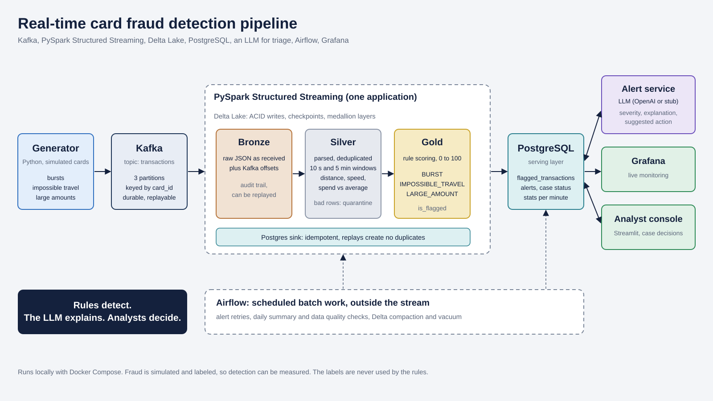

# Real-time card fraud detection pipeline

A streaming pipeline that detects fraudulent card transactions, explains each flag with an LLM, and lets analysts record a decision. Everything runs locally with Docker Compose, including on an 8 GB laptop.



**Rules detect. The LLM explains. Analysts decide.** Detection is plain, testable rules. The LLM never decides what is fraud, it only writes the severity, explanation and suggested action for a transaction the rules already flagged.

> Demo video: [https://youtu.be/NCplOyPFYws?si=QTu9FoiK_mCE-lf5]

## What it does

1. **Generator** (Python) simulates card transactions and injects labeled fraud: bursts, impossible travel and unusually large amounts.
2. **Kafka** ingests the events (topic `transactions`, 3 partitions, keyed by `card_id`).
3. **PySpark Structured Streaming** runs one application with four streams: bronze, silver, gold, and a Postgres sink.
4. **Delta Lake** stores bronze (raw), silver (parsed, deduplicated, features, quarantine for bad rows) and gold (scored).
5. **PostgreSQL** serves flagged transactions, alerts and per-minute stats through an idempotent sink.
6. **Alert service** sends each flag to an LLM (OpenAI, or a built-in stub) and saves severity, explanation and action.
7. **Airflow** runs scheduled batch work: alert retries, daily summaries and quality checks, Delta compaction.
8. **Grafana** shows live monitoring, and a **Streamlit** console lets analysts review alerts and record case decisions.

## Detection rules

| Rule | Condition | Score |
|---|---|---|
| `BURST` | 4 or more transactions on a card within 10 seconds | 40 |
| `IMPOSSIBLE_TRAVEL` | more than 100 km from the previous transaction at over 900 km/h | 50 |
| `LARGE_AMOUNT` | at least 3 earlier transactions and amount above 5x the card's own average | 40 |

The risk score is the sum, capped at 100. Thresholds are read from `data/config/thresholds.json`, with defaults in `pipeline.py`.

## Results on simulated data

| Burst rule | Precision | Recall (per event) |
|---|---|---|
| 5 in 5 minutes | 15.1% | 92.6% |
| 4 in 10 seconds | **82.6%** | 65.6% |

The first rule flagged normal cards, because a card averages about 7 transactions per 5 minutes in this simulation. A 10-second window fixed that. Per-event recall is lower because a count rule cannot flag the first 3 events of a burst, but each burst still raises an alert. These figures come from simulated data and show the pipeline works, not how it would perform on real card data.

## Tech stack

Python, Kafka (KRaft), PySpark 3.5, Delta Lake 3.2, PostgreSQL 16, OpenAI API, Apache Airflow 2.10, Grafana 11, Streamlit, SQL, Docker Compose.

## Quick start

**Prerequisites:** Docker Desktop, Python 3.10 to 3.12, Git. On an 8 GB machine, cap Docker's memory at about 4 GB (`.wslconfig`: `memory=4GB`). Run Airflow and the streaming stack separately, because they do not fit together in 4 GB.

```powershell
git clone <your-repo-url>
cd fraud-pipeline
python -m venv .venv
.venv\Scripts\Activate.ps1
python -m pip install confluent-kafka psycopg2-binary openai
```

Create a `.env` file in the project root (it is git-ignored):

```
APP_DB_PASSWORD=choose-a-password
```

Start the services and set up the database:

```powershell
docker compose up -d kafka postgres spark grafana

docker cp sql\schema.sql postgres:/tmp/schema.sql
docker exec postgres psql -U fraud -d frauddb -v ON_ERROR_STOP=1 -f /tmp/schema.sql
docker cp sql\grafana_ro.sql postgres:/tmp/grafana_ro.sql
docker exec postgres psql -U fraud -d frauddb -v ON_ERROR_STOP=1 -f /tmp/grafana_ro.sql
```

For the analyst console, put your password in place of `CHANGE_ME` in `sql\analyst_app.sql`, apply it the same way, then `docker compose up -d analyst-app`. Never commit the real password.

```powershell
docker exec kafka /opt/kafka/bin/kafka-topics.sh --create --topic transactions --bootstrap-server kafka:9092 --partitions 3 --replication-factor 1
```

## Run it

Use one terminal each, and start the pipeline before the generator.

```powershell
# 1. The pipeline (wait for "All four streams are running")
docker exec -e TRIGGER_SECONDS=5 -it spark /opt/spark/bin/spark-submit --driver-memory 1500m --conf spark.ui.enabled=false --packages org.apache.spark:spark-sql-kafka-0-10_2.12:3.5.3,io.delta:delta-spark_2.12:3.2.0,org.postgresql:postgresql:42.7.4 --conf spark.jars.ivy=/tmp/.ivy2 /opt/app/pipeline.py

# 2. The alert service (stub mode needs no key)
$env:PGHOST = "127.0.0.1"; $env:PGPORT = "5433"; $env:LLM_MODE = "stub"; $env:MAX_ALERTS_PER_RUN = "25"
python alerts\alert_service.py --watch

# 3. Normal traffic
python generator\producer.py --rate 5 --fraud-prob 0.02

# 4. Fire fraud on demand
python generator\inject.py --scenario travel     # or burst, large, all
```

| Service | URL | Login |
|---|---|---|
| Grafana | http://localhost:3000 | admin / admin (local only) |
| Analyst console | http://localhost:8501 | none |
| Airflow | http://localhost:8088 | admin, password in `/opt/airflow/standalone_admin_password.txt` |
| Postgres (from the host) | 127.0.0.1:5433 | fraud / fraud (local only) |

Postgres is mapped to host port 5433 because 5432 is often taken by a local install. Containers use `postgres:5432`.

**Real OpenAI:** set `LLM_MODE=openai`, `OPENAI_MODEL=gpt-4o-mini` and `OPENAI_API_KEY` in the terminal only, never in a file. `MAX_ALERTS_PER_RUN` limits one pass, so also set a monthly spending limit in your OpenAI billing settings.

**Clean start** (deletes the Delta tables, checkpoints, Kafka topic and Postgres rows):

```powershell
powershell -ExecutionPolicy Bypass -File scripts\reset.ps1
```

**Airflow** (stop the streaming stack first): `docker compose up -d airflow`, then `docker exec airflow airflow dags test fraud_daily 2026-11-01`.

## Design decisions

- **Medallion layers.** Bronze keeps the raw event, so silver and gold can be rebuilt without touching Kafka.
- **Window features in `foreachBatch`.** Spark streaming does not support `lag()` or per-card running averages directly, so each micro-batch is combined with 1 day of silver history, and rows already written are dropped.
- **Idempotent sink.** Spark appends to Postgres views. `INSTEAD OF INSERT` triggers do `ON CONFLICT` upserts, so replays and retries never duplicate rows.
- **Labels stay out of detection.** `label_is_fraud` and `label_fraud_type` exist only for evaluation. The analyst app's database role cannot read them.
- **Least privilege.** Grafana uses a read-only role. The analyst role can update only `case_status`, `assigned_to` and `updated_at` on `alerts`.
- **Alert state machine.** `PENDING`, `DONE` and `FAILED` with an attempt counter. Airflow requeues failed alerts, and `FOR UPDATE SKIP LOCKED` stops two workers taking the same alert.

## Known limitations

- **Return-leg false positives.** After a foreign transaction, the next normal one at home also looks like impossible travel. This is the main source of false positives, and it lands in the high-severity bands. A fix is to ignore a jump when the transaction two back is within 100 km of the current one.
- **Cold start.** A card needs 3 earlier transactions before the large-amount rule can fire.
- **Baseline contamination.** An earlier fraud amount raises a card's average. A median, or excluding flagged transactions, would help.
- **The LLM sees one transaction without card history**, so it cannot tell a return leg from a new trip.
- **`fraud_thresholds` DAG.** The DAG that tunes thresholds against labels is not working yet. The `deltalake` and `pyarrow` versions in the Airflow image could not read the compacted tables.
- **Simulated data**, and a single-node setup meant for a laptop.

## Repository layout

```
docker-compose.yml
generator/   producer.py (traffic and random fraud), inject.py (fraud on demand)
spark/       pipeline.py (all streams), common.py, original per-layer jobs, check and evaluate scripts
alerts/      alert_service.py
airflow/dags retry, daily checks, Delta maintenance, thresholds
sql/         schema.sql, grafana_ro.sql, analyst_app.sql
grafana/     provisioning and dashboards/fraud.json
app/         Streamlit analyst console
scripts/     reset.ps1
docs/        architecture.svg
```

## Security note

The passwords in this repo (`fraud`, `grafana_ro`, Grafana `admin`) are for local development only. Do not expose these ports to a network. Keep real secrets, including `OPENAI_API_KEY` and the analyst password, in environment variables or the git-ignored `.env`.